# Boletim Usefaz

## Requisitos

- Docker (com Compose v2)
- Node >= 26 (o pnpm baixa a versão definida em `devEngines` automaticamente)
- pnpm (`corepack enable` instala a versão definida em `package.json`)

## Estrutura

Monorepo com [pnpm workspaces](https://pnpm.io/workspaces). As versões compartilhadas ficam no `catalog` do `pnpm-workspace.yaml`.

| Pacote                 | Descrição                                                        |
| ---------------------- | ---------------------------------------------------------------- |
| `apps/server`          | API GraphQL (Koa + graphql-http + Knex/PostgreSQL)               |
| `apps/boletim`         | Sistema de Boletim (React + Relay + Vite)                        |
| `apps/admin`           | Sistema do Administrador (React + Relay + Vite)                  |
| `packages/ui`          | Componentes React compartilhados (Tailwind + shadcn com Base UI) |
| `packages/relay`       | Environment do Relay                                             |
| `packages/shared`      | Utilitários compartilhados entre front-end e servidor            |
| `packages/vite-config` | Configuração do Vite usada pelos apps                            |

## Iniciando

### Desenvolvimento (com Docker)

- `pnpm install`: Instala as dependências do projeto
- Copie o arquivo `.env.example` do `apps/server` para `.env`
- `pnpm dev`: Inicia os containers do projeto
  - Se a porta 3000 estiver ocupada, use `SERVER_PORT=3010 pnpm dev`: a API sobe na 3010 e os apps passam a chamá-la lá
- `pnpm seed`: Alimenta o banco com dados de teste
- Abra o Sistema de Boletim em `http://localhost:8080`
  - Login `12345`
  - Password `123`
- Abra o Sistema do Administrador em `http://localhost:8081`
  - Login `lucasgdbittencourt@gmail.com`
  - Password `123`
- `pnpm stop`: Desliga o projeto.

### Scripts

- `pnpm lint` / `pnpm lint:fix`: Lint e formatação com [Biome](https://biomejs.dev)
- `pnpm typecheck`: Gera os artefatos do Relay e checa os tipos de todos os pacotes
- `pnpm build`: Gera o build de produção de todos os apps

## Telas do Sistema de Boletim

### Login

  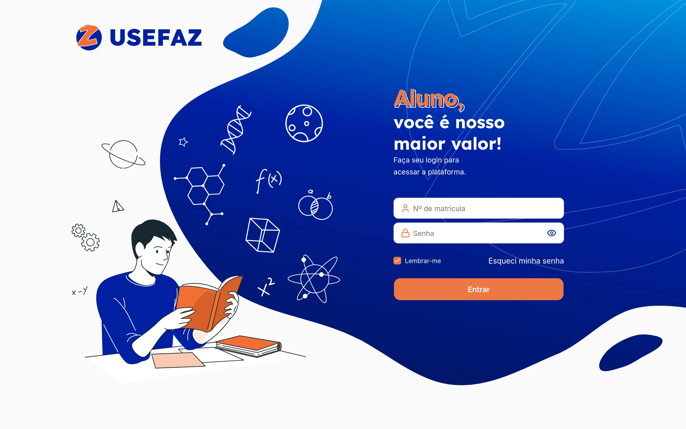

### Página inicial

  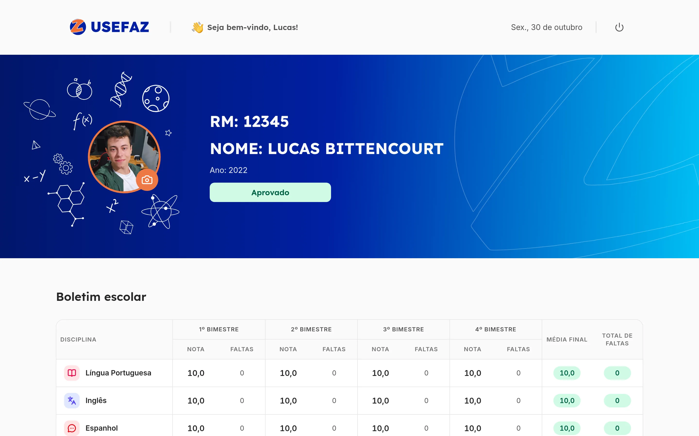

### Outras telas

<table>
  <tr>
    <td width="50%" valign="top">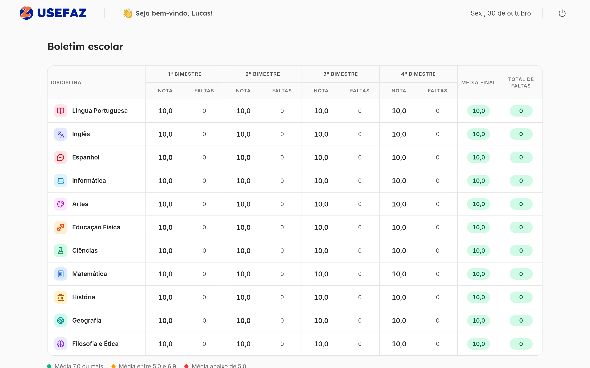 Boletim com notas, faltas e médias</td>
    <td width="50%" valign="top">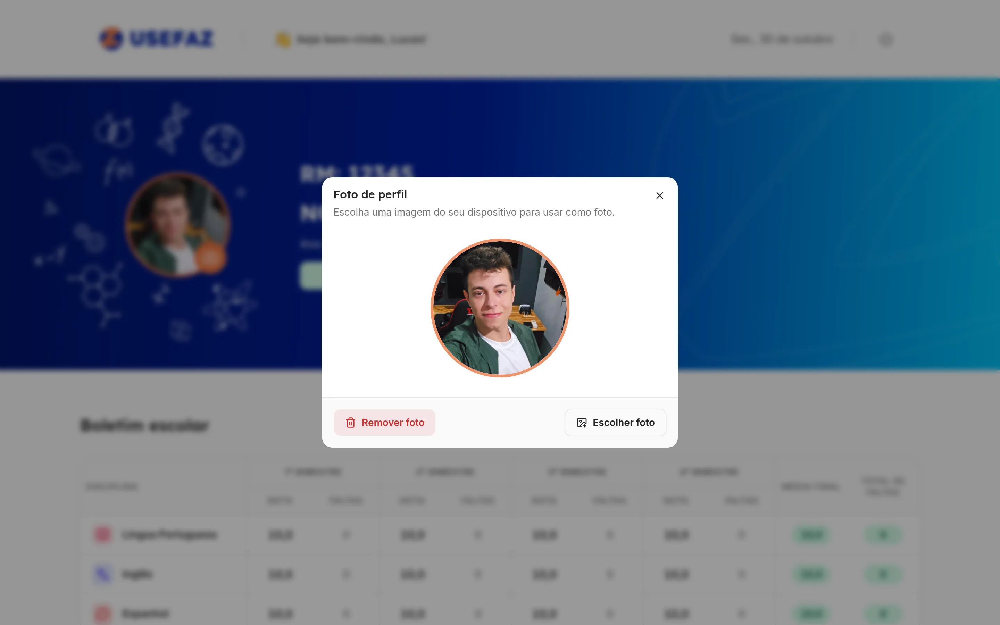 Foto de perfil</td>
  </tr>
  <tr>
    <td width="50%" valign="top"> Erro do servidor no formulário</td>
    <td width="50%" valign="top">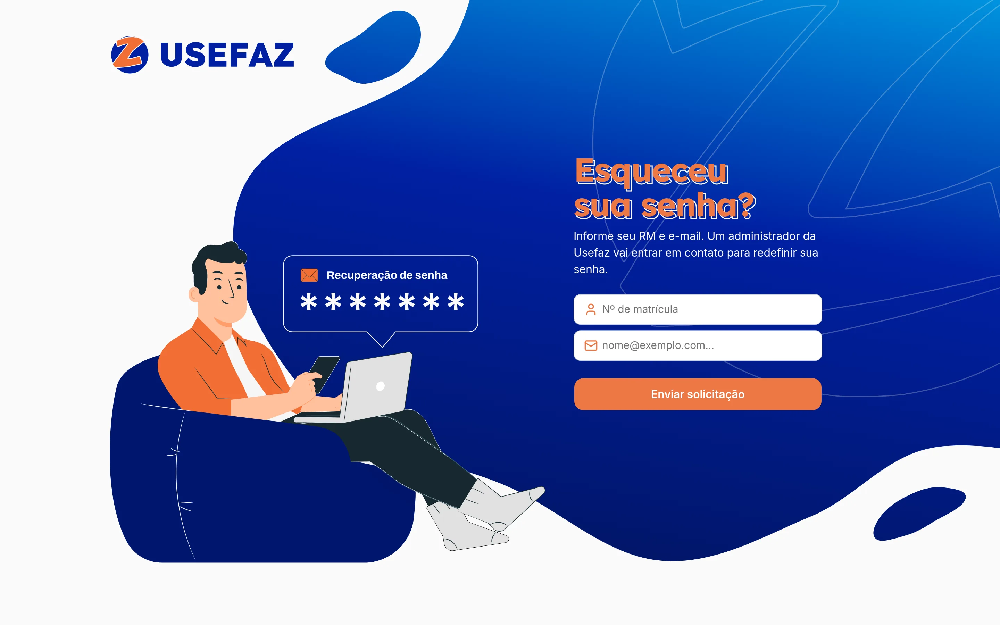 Recuperação de senha</td>
  </tr>
  <tr>
    <td width="50%" valign="top">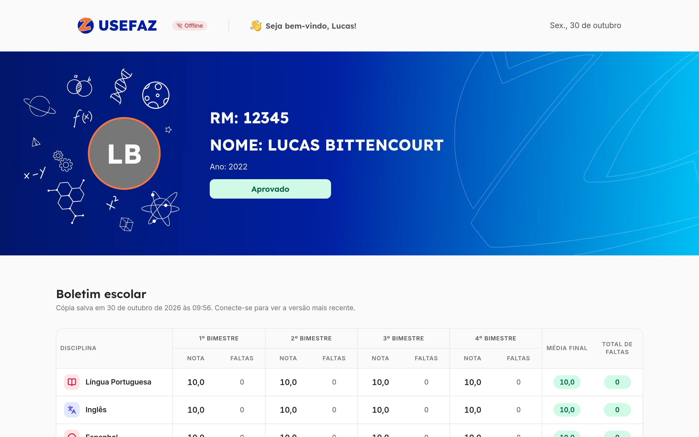 Modo offline (PWA) com a última cópia salva</td>
    <td width="50%" valign="top">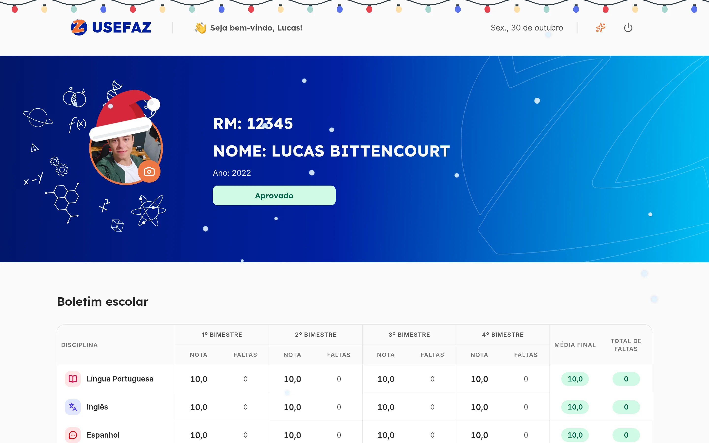 Tema de Natal</td>
  </tr>
</table>

Datas comemorativas (Natal, Halloween, Páscoa, Festa Junina, entre outras) decoram o boletim e a foto do aluno. Para ver um tema fora da época, use `?tema=natal` (ou `?tema=off` para desligar).

### Celular

<table>
  <tr>
    <td width="25%" valign="top" align="center">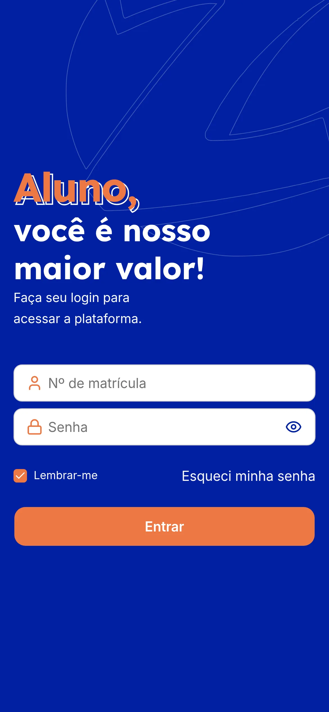 Login</td>
    <td width="25%" valign="top" align="center">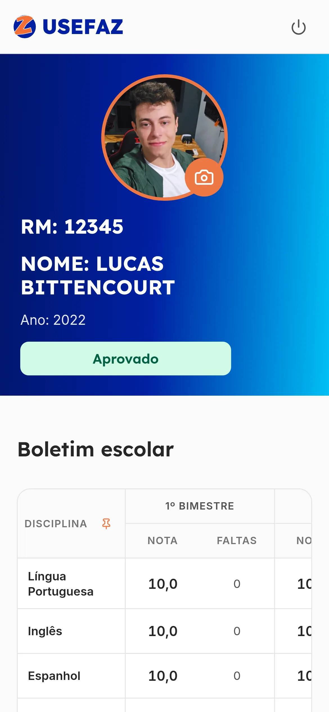 Perfil</td>
    <td width="25%" valign="top" align="center">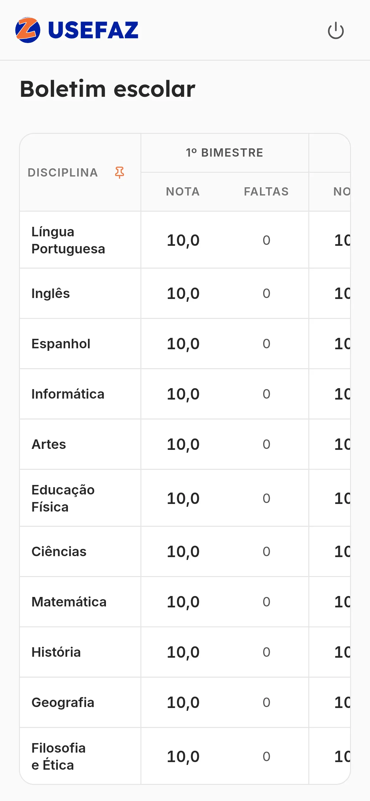 Boletim</td>
    <td width="25%" valign="top" align="center">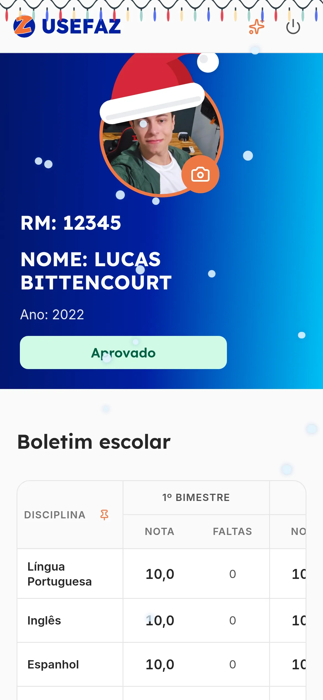 Tema de Natal</td>
  </tr>
</table>

## Autor

| [ @lucasgdb](https://github.com/lucasgdb) |
| :----------------------------------------------------------------------------------------------------------------------------: |
